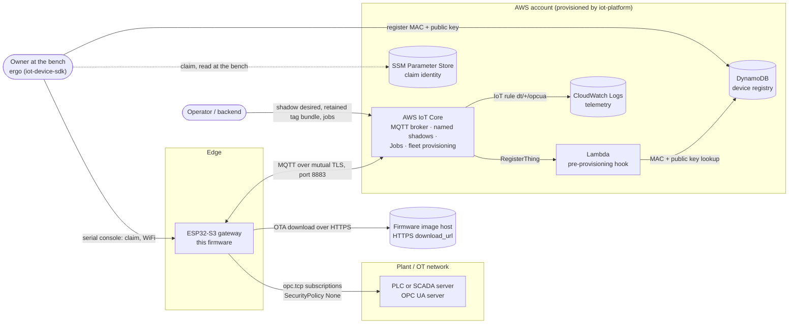
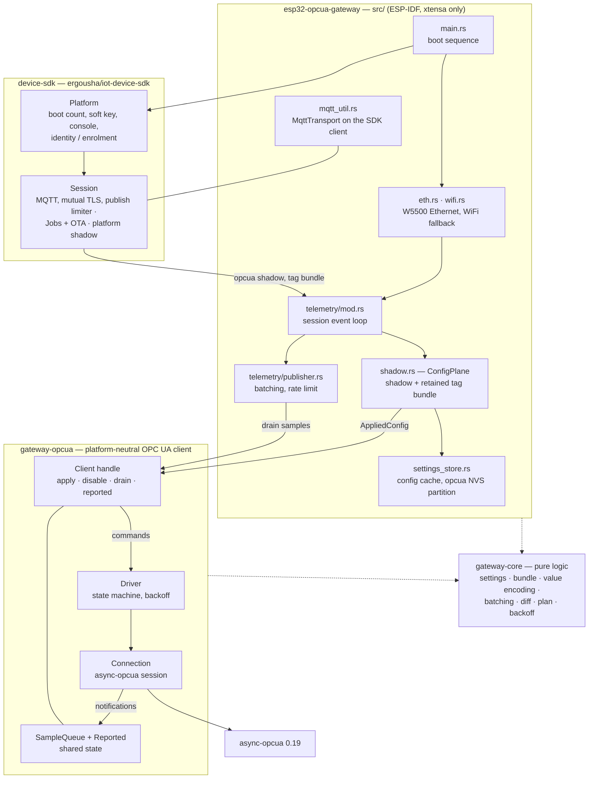
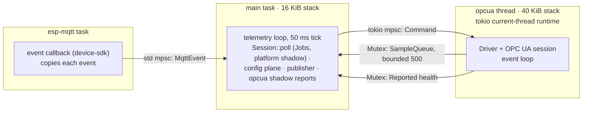
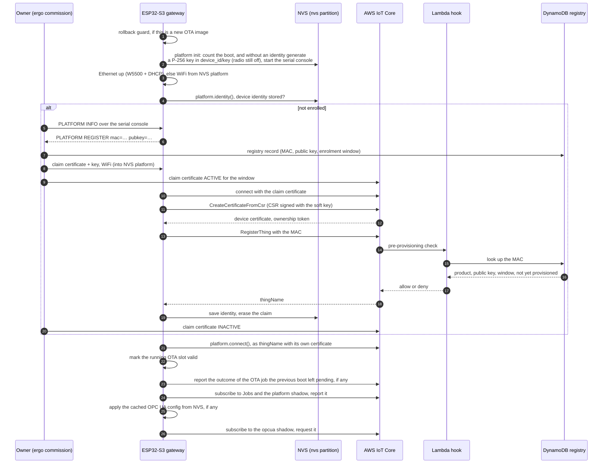
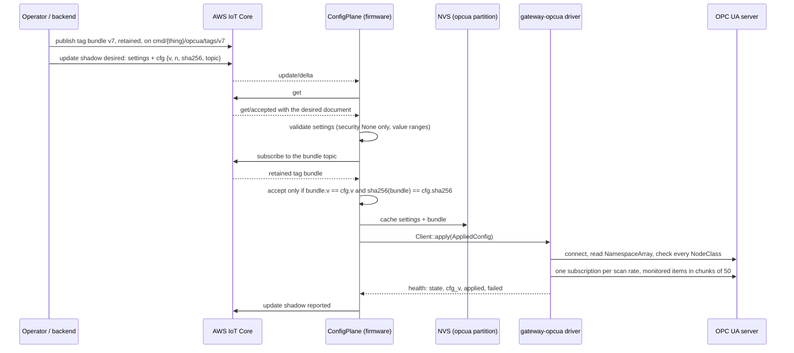
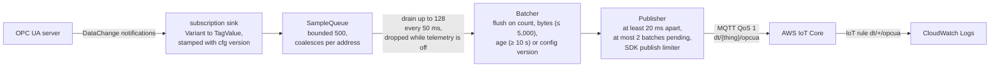
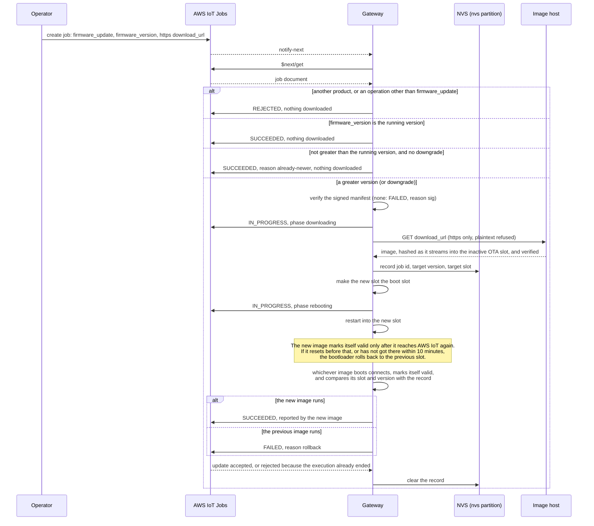
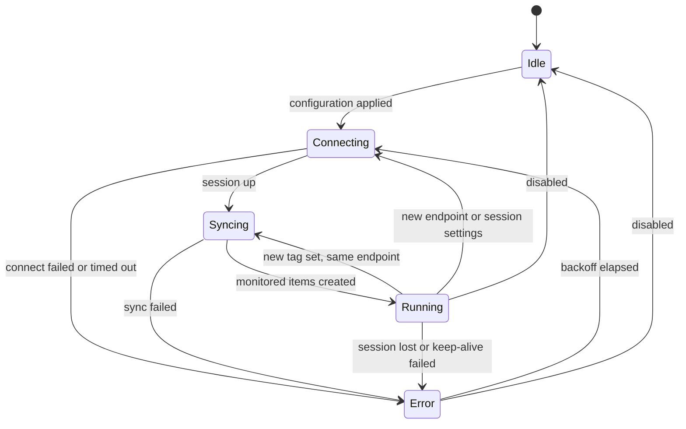
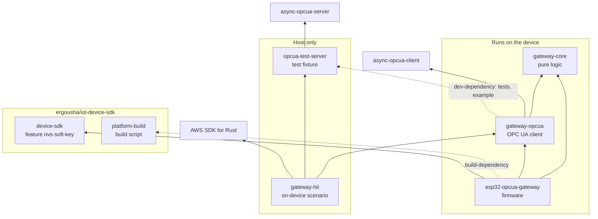
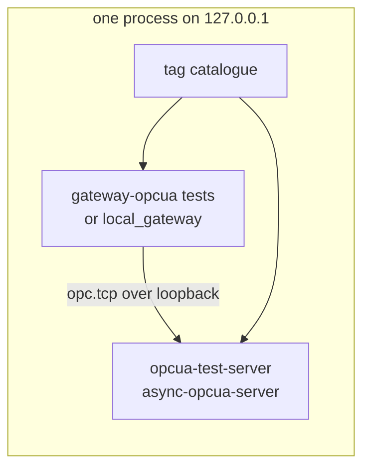

# ESP32-S3-ETH OPC UA Gateway (Rust)

An edge gateway that reads tags from a PLC over **OPC UA** and publishes them to
**AWS IoT Core**. It runs as `std` Rust on ESP-IDF on the
[Waveshare ESP32-S3-ETH](hardware/README.md), an ESP32-S3 (Xtensa LX7) with an
on-board W5500 wired Ethernet chip.

- **On the Ergousha IoT platform.** Enrolment, AWS IoT Jobs (OTA), the
  `platform` shadow and the bench console come from the platform's device SDK,
  [`ergousha/iot-device-sdk`](https://github.com/ergousha/iot-device-sdk)
  (`device-sdk`, feature `nvs-soft-key`). This repository is the gateway on top
  of it.
- **Enrolment with its own key, no secrets in the image.** The device generates
  a P-256 key in NVS and, with a claim written to it at the bench
  (`ergo commission`), obtains its X.509 certificate through AWS IoT *Fleet
  Provisioning by Claim* from a CSR. It keeps the identity in NVS and from then
  on connects as itself. A build needs no AWS access.
- **Configured from the cloud, not at build time.** Which server to read, which
  tags, how often and how to batch them all arrive at runtime through a device
  shadow plus a retained tag bundle. The last good configuration is cached on
  flash, so the gateway keeps collecting when the WAN is down.
- **OPC UA subscriptions, batched telemetry.** Values are reported by exception,
  encoded losslessly, and published in size- and rate-limited batches, only
  while the platform has switched telemetry on.
- **Remote firmware updates** through AWS IoT Jobs, into dual OTA slots with
  automatic rollback.
- **Testable without hardware.** Everything except device I/O builds for the
  development host, including the OPC UA client, which is tested end to end
  against a real OPC UA server over loopback.

Networking tries wired Ethernet (W5500 + DHCP) first and falls back to WiFi
(from NVS `platform`, written at the bench) when there is no link or lease.

**Contents:**
[Architecture](#architecture) ·
[Repository layout](#repository-layout) ·
[Running and testing without hardware](#running-and-testing-the-opc-ua-client-without-hardware) ·
[Getting started](#getting-started) ·
[Commissioning](#commissioning-a-gateway) ·
[Hardware](#hardware) ·
[Documentation](#documentation)

---

## Architecture

### System context



| External system | What the gateway exchanges with it |
| --- | --- |
| **OPC UA server** (PLC / SCADA) | The gateway is the OPC UA *client*: it opens one session, one subscription per scan rate, and reads the `NamespaceArray` to resolve namespace URIs. Phase 1 is SecurityPolicy `None` + anonymous only, on a trusted OT network. |
| **AWS IoT Core** | One mutually authenticated MQTT connection carries every plane: enrolment, the `platform` and `opcua` named shadows, the retained tag bundle, Jobs, and telemetry. |
| **DynamoDB registry + Lambda** | Enrolment succeeds only for a MAC and public key registered here, once, inside its enrolment window (`ergo commission`, below). |
| **CloudWatch Logs** | Where the `dt/+/opcua` IoT rule lands telemetry; also what the on-device test reads. The rule lives in this repository's [`cloud/`](cloud/README.md) and is off by default to save cost: enable it with `terraform apply -var debug_telemetry_logs=true` there for debugging or a HIL run. The gateway publishes only while the `platform` shadow's `desired.telemetry.enabled` is `true`. |
| **SSM Parameter Store** | Holds the claim certificate and key, which `ergo commission` reads at the bench and writes to the device over its serial console. Never read by the build or contacted by the device. |
| **Image host** | The HTTPS `download_url` of an OTA job, typically a presigned S3 URL. |

The AWS resources — IoT policy, provisioning template, Lambda hook, registry
table, IoT rule and SSM parameters — live in the separate
[`iot-platform`](https://github.com/ergousha/iot-platform) repository.

### Components



The firmware crate is the only part of this repository tied to the device. It
is a thin effectful shell: networking, the `opcua` shadow, the NVS config
cache, and the glue between them. Identity, enrolment, the MQTT connection,
Jobs and OTA are the platform SDK's: the session handles Jobs and the
`platform` shadow itself and hands the gateway only its own messages. The
decisions — what a valid configuration is, how a value is encoded,
when a batch is flushed, how long to back off — live in `gateway-core` as pure
functions. The OPC UA client lives in `gateway-opcua`, which the firmware
plugs in through a single handle:

```rust
let (client, driver) = gateway_opcua::new(options);          // clock, backoff seed
gateway_opcua::spawn_thread(driver, "opcua", 40 * 1024)?;    // own thread + runtime
client.apply(config)?;           // from the config plane
let samples = client.drain(128); // from the telemetry loop
let health = client.reported();  // mirrored into the shadow
```

### Runtime and concurrency



The OPC UA stack is isolated on its own thread and runtime. It talks to the MQTT
loop only through a bounded, coalescing sample queue and a command channel, so
an unreachable or misbehaving PLC can never stall the path that delivers a
firmware update. The driver never panics; every failure becomes
`reported.last_error` and a backoff.

### Boot and provisioning



A refused enrolment is retried with a backoff from 60 s to 6 h. Units enrolled
before the SDK keep the RSA identity `CreateKeysAndCertificate` gave them,
in NVS `device_id` (certificate, key, thing name; a frozen layout), and keep
connecting with it. New enrolments no longer use `CreateKeysAndCertificate` or
a shared device secret.

### Configuration plane

A 250-tag list does not fit in AWS IoT's 8 KB shadow limit, so configuration
travels on two planes. The named shadow `opcua` carries the small settings and
a **pointer** to the tag list; the list itself is a compact, grouped **tag
bundle** published *retained*, so a rebooting device receives it on subscribe.



The version-and-digest gate lives in one place, `gateway_opcua::AppliedConfig::new`,
whichever way a configuration arrives: MQTT, the NVS cache, or a file on a
laptop. The two planes therefore cannot desynchronise silently, and
re-delivering an applied version is a no-op. A security policy other than
`None` is **refused**, never downgraded. Schema and limits:
[`docs/OPCUA_CLIENT_REQUIREMENTS.md`](docs/OPCUA_CLIENT_REQUIREMENTS.md) §4.

### Telemetry data flow



A batch is a positional array of rows, `[address, source_ts_ms, value]`, plus a
4th element carrying the StatusCode only when it is not Good:

```json
{"t":1753660800000,"v":7,
 "d":[["Line1.Temp",1753660799871,23.5],
      ["Line1.BigCounter",1753660799902,{"$t":"i64","v":"9007199254740993"}],
      ["Line1.Faulty",1753660799910,null,2156396544]]}
```

- Values are self-describing and lossless: integers beyond 2⁵³, byte strings
  and GUIDs are tagged (`{"$t":"i64"|"u64"|"b64"|"guid","v":"…"}`) rather than
  squeezed through a double, and `f32` is widened by its shortest decimal
  form.
- `v` is the configuration version the rows were **collected** under; a batch
  never mixes two.
- **Telemetry is opt-in.** Batches are published only while the `platform`
  shadow has `desired.telemetry.enabled = true`; otherwise samples are still
  drained, and dropped, so the queue never backs up.
- Every publish on the connection passes the SDK's publish limiter (10 a minute
  and 5 KB each by default). Batches are therefore clamped to at most 5,000
  bytes and at least 10 s apart, whatever the shadow asks for
  (`TelemetrySettings::effective`, `PUBLISH_BATCH_BYTES`,
  `MIN_PUBLISH_BATCH_AGE_MS` in `gateway-core`), which leaves room for shadow
  and Jobs traffic. The defaults are 5,000 bytes and 60 s.
- The topic may also be a Basic Ingest topic, `$aws/rules/gateway_<rule>[/…]`,
  which goes straight to one of this product's IoT rules with no messaging
  charge; the platform's device policy allows exactly that prefix. Any other
  `$` topic is refused.
- The queue and the batch limits bound memory.

### Firmware updates (OTA)



The image that downloads an update never reports it SUCCEEDED: until the new
image has reached AWS IoT and marked itself valid, the bootloader can still
roll it back. The outcome is reported by whichever image runs after the
reboot, from the record kept in NVS. Until the Jobs service has acknowledged
it, the device takes no other job, and the execution the service offers again
at boot (still IN_PROGRESS) is settled, never downloaded a second time. A fresh
image that fails before it can mark itself valid restarts rather than stopping,
so the bootloader does roll it back. All of this is the platform SDK's
(`iot-jobs` and `device-sdk` in `ergousha/iot-device-sdk`); failure reasons are
`verify`, `sig`, `version`, `rollback`, `boot` and `download`. The full flow,
its edge cases, and a hardware check for a good and a bad update:
[`docs/FIRMWARE_INTEGRATION.md`](docs/FIRMWARE_INTEGRATION.md) §4.

### OPC UA driver lifecycle



The state is mirrored into the shadow's `reported.state`. The driver's jittered
exponential backoff (1 s doubling to 60 s) is the only retry mechanism —
async-opcua's own reconnect loop is switched off, so a dead or silent server is
reported as `error` within seconds instead of looking `running`, and a fleet
does not reconnect in lockstep after a server restart. A live reconfiguration
on the same endpoint rebuilds the subscriptions without reconnecting; a disable
completes within 3 s even if the server never answers.

### MQTT interface

| Topic | Direction | Plane | Purpose |
| --- | --- | --- | --- |
| `$aws/certificates/create-from-csr/json` (`/accepted`, `/rejected`) | both | enrolment | CreateCertificateFromCsr, only until the device is enrolled, on the claim connection |
| `$aws/provisioning-templates/{template}/provision/json` (`/accepted`, `/rejected`) | both | enrolment | RegisterThing |
| `$aws/things/{thing}/shadow/name/platform/get` (`/accepted`, `/rejected`), `…/platform/update` (`/delta`) | both | platform | `desired.telemetry.enabled` in; `reported` (`contract, product, fw, slot, boot_reason, boot_count_since_update, uptime_s, key_id[], last_job, telemetry`) out on connect, on change and every 6 h |
| `$aws/things/{thing}/shadow/name/opcua/get` (`/accepted`, `/rejected`) | both | config | read `state.desired` |
| `$aws/things/{thing}/shadow/name/opcua/update` (`/delta`, `/rejected`) | both | config | change notifications in, `state.reported` out |
| `cmd/{thing}/opcua/tags/v{N}` | cloud → device, retained | config | the tag bundle for config version N |
| `$aws/things/{thing}/jobs/notify-next`, `…/jobs/$next/get` (`/accepted`), `…/jobs/{jobId}/update` (`/accepted`, `/rejected`), `…/jobs/{jobId}/get` (`/accepted`, `/rejected`) | both | control | OTA jobs and their status; `{jobId}/get` asks, before an image is activated, whether its job is still wanted |
| `dt/{thing}/opcua` (set in the shadow's `telemetry.topic`; or a Basic Ingest topic `$aws/rules/gateway_<rule>[/…]`) | device → cloud | data | telemetry batches, only while the platform switch is on |

The `opcua` shadow's `reported` is sent when the driver state, `cfg_v`, the
applied or failed tag counts or `last_error` change, and otherwise every 6 h:
every update is a billed message.

The platform's device policy grants exactly the topics above (iot-device-sdk
`PLATFORM.md` §6; no shadow `update/accepted` or `update/documents`), so a new
subscription must be added there first: an unauthorised SUBSCRIBE makes AWS
IoT drop the **whole** connection, Jobs and OTA included
([`docs/OPCUA_INTEGRATION_TEST.md`](docs/OPCUA_INTEGRATION_TEST.md) §8.1).

### Key architectural decisions

| Aspect | Decision | Why |
| --- | --- | --- |
| Isolation | OPC UA on its own thread and tokio runtime; bounded queue + command channel to the MQTT loop | A PLC problem must never block MQTT, Jobs or OTA. |
| Configuration transport | Shadow pointer + retained tag bundle | 250 tags do not fit the 8 KB shadow. |
| Configuration integrity | Applied only when version **and** SHA-256 match | The two planes cannot desynchronise; torn or stale bundles are refused. |
| Offline operation | Last good configuration cached in the dedicated `opcua` NVS partition, applied at boot | Keep collecting when the WAN is down; a large bundle can never evict the device identity. |
| OPC UA security | SecurityPolicy `None`, anonymous; anything else refused; a warning logged on every connect | No filesystem, no key store (decisions D2/D3). The OT network is treated as trusted. |
| Retry | One jittered backoff, in the driver | Failures stay visible; no fleet-wide reconnect storms. |
| Tag validity | NodeClass checked before subscribing | "Failed tag" means the same thing on every server, strict or lenient. |
| Telemetry format | Positional rows, self-describing lossless values, status only when not Good | Small payloads without silent data loss. |
| Backpressure | Coalescing queue, count/size/age batching, spaced publishes | Bounded heap; well inside AWS IoT publish limits. |
| Memory budget | 250-tag cap, 16 KiB OPC UA messages, type table preloaded at boot, mbedTLS dynamic buffers | ~300 KB of heap and no PSRAM. |
| Identity | Per-device X.509 from fleet provisioning by claim with a CSR for a P-256 key generated on the device; the claim written at the bench, gated by a MAC + public key registry and an enrolment window | The private key never leaves the device, only registered devices can enrol, and the image carries no secrets. |
| Platform | Enrolment, MQTT, Jobs/OTA and the `platform` shadow from `ergousha/iot-device-sdk` | One implementation for every product on the platform, with one publish limiter bounding the bill. |
| Cost | Telemetry off until the platform switches it on; batches ≤ 5,000 bytes, ≥ 10 s apart; shadow reports on change or every 6 h | AWS IoT bills per message and per 5 KB. |
| Updates | HTTPS-only OTA into dual 7 MiB slots, only to a greater version unless the job says `downgrade`, rollback until the new image reaches AWS; the job outcome reported after the reboot, by the image that actually runs | A bad image cannot brick a unit in the field, and a rollback cannot pass for a success. |
| Testability | Everything but device I/O builds for the host; OPC UA tested against a server from the same library | Fast feedback, and no dependence on a LAN or host firewall. |
| Flash layout | Frozen, with spare partitions reserved up front | The partition table is not rewritten by OTA. |

The full rationale for the OPC UA side is in
[`docs/OPCUA_CLIENT_REQUIREMENTS.md`](docs/OPCUA_CLIENT_REQUIREMENTS.md) §9.

### Flash layout

16 MiB flash, defined in [`partitions.csv`](partitions.csv). The table is **not**
rewritten by an OTA update, so it is frozen for every unit that has left the
bench.

| Partition | Offset | Size | Holds |
| --- | --- | --- | --- |
| `nvs` | `0x9000` | 24 KiB | device identity and key (`device_id`), claim, WiFi, endpoint override and boot count (`platform`), the pending OTA job (`ota_job`) |
| `phy_init` | `0xf000` | 4 KiB | RF calibration |
| `otadata` | `0x10000` | 8 KiB | which OTA slot boots |
| `nvs_key` | `0x12000` | 4 KiB | reserved: NVS encryption keys |
| `opcua` | `0x13000` | 52 KiB | cached OPC UA settings + tag bundle |
| `ota_0` / `ota_1` | `0x20000` / `0x720000` | 7 MiB each | application slots (image ≈ 5.3 MB) |
| `storage` | `0xe20000` | 1664 KiB | reserved: future filesystem / telemetry spool, not mounted |
| `coredump` | `0xfc0000` | 256 KiB | reserved: panic core dumps |

---

## Repository layout

A Cargo workspace. Only the firmware crate at the root is tied to the device;
everything else builds and runs on the development host. The platform side —
enrolment, OTA, the `platform` shadow, the bench console, and `ergo`, the
owner's CLI — is in
[`ergousha/iot-device-sdk`](https://github.com/ergousha/iot-device-sdk), which
the firmware depends on (`device-sdk`, and `platform-build` for the build
script). `Cargo.toml` points at a checkout of it next to this one
(`../iot-device-sdk`).

```
.
├── src/                     # the firmware (ESP-IDF, xtensa only)
│   ├── main.rs              # boot: platform init -> eth/WiFi -> identity -> connect -> telemetry
│   ├── eth.rs, wifi.rs      # W5500 via esp_eth (DHCP); WiFi fallback (NVS platform)
│   ├── telemetry/           # normal operation: session loop + batched publisher
│   ├── shadow.rs            # config plane: `opcua` named shadow + tag bundle
│   ├── settings_store.rs    # NVS cache of the last applied OPC UA config
│   └── mqtt_util.rs         # the MqttTransport trait, on the SDK's MQTT client
├── gateway-core/            # pure logic: settings, bundle, encoding, batching, backoff
├── gateway-opcua/           # the OPC UA client: session, subscriptions, reconnect
│                            # state machine — platform-neutral, plugged into src/
├── opcua-test-server/       # OPC UA test server on async-opcua-server (the server
│                            # half of the client's own library) + tag catalogue
├── gateway-hil/             # on-device scenario runner (ESP32 + AWS + test server)
├── crates/                  # vendored [patch.crates-io] sources (ESP-IDF fixes)
├── platform.toml            # this product on the platform: chip, MAC type, key storage,
│                            # IoT endpoint and template (public), frozen partitions
├── build.rs                 # platform_build::configure(): reads platform.toml, pins
│                            # FW_VERSION, stages the bootloader; no AWS access
├── partitions.csv           # the frozen flash layout
├── scripts/scan-image.py    # fails a release image that carries a key or an unexpected certificate
├── certs/                   # the Amazon root CA (see certs/README.md)
└── docs/                    # firmware notes, OPC UA requirements, test architecture
```

How the crates depend on each other:



## Running and testing the OPC UA client without hardware

The OPC UA client is written against no device API, so it runs on a laptop
exactly as it runs on the ESP32. Host builds only need `--target host-tuple`,
which overrides the xtensa default in `.cargo/config.toml`:

```sh
# unit tests of the pure logic
cargo test -p gateway-core --target host-tuple

# the real client against a real OPC UA server, both in one process on
# 127.0.0.1: provisioning, every value encoding, live reconfiguration, server
# loss and recovery, a silent link, disable — ~20 s, no device, no firewall
cargo test -p gateway-opcua --target host-tuple

# run the client interactively; telemetry is printed as it would be published
cargo run -p gateway-opcua --example local_gateway --target host-tuple

# …or point it at a real PLC on the LAN (the laptop dials out)
cargo run -p gateway-opcua --example local_gateway --target host-tuple -- \
    --endpoint opc.tcp://192.168.1.50:4840 --ns 3 --tag Channel1.Device1.Tag1

# the OPC UA test server on its own, for a device to dial
cargo run -p opcua-test-server --target host-tuple -- --bind 0.0.0.0 --host <lan-ip>
```



The server is `async-opcua-server`, the server half of the library the client
uses, so both ends speak the same stack, and one tag catalogue drives both the
server's nodes and the configuration the client is given. The on-device
scenario (`cargo run -p gateway-hil`) covers what only hardware can show: heap,
the ESP-IDF runtime, NVS and the AWS planes. On a host the device cannot reach,
such as a firewalled workstation, `--offline` runs the part that needs no route
back to the host. See
[`docs/OPCUA_INTEGRATION_TEST.md`](docs/OPCUA_INTEGRATION_TEST.md) §7.

---

## Getting started

### Toolchain

The ESP32-S3 (Xtensa LX7) needs Espressif's Rust fork instead of upstream
`rustc`, plus the native ESP-IDF build tools (`std` firmware links against
ESP-IDF, unlike a bare-metal `no_std` build):

```sh
cargo install espup --locked
espup install --targets esp32s3
. ~/export-esp.sh                # in every new shell before building

cargo install ldproxy --locked   # linker shim required by .cargo/config.toml
cargo install espflash --locked  # flashing and the serial monitor
```

The first build downloads and builds the ESP-IDF version pinned in
[`.cargo/config.toml`](.cargo/config.toml) (`ESP_IDF_VERSION`) via `embuild`.
That needs `python3`, `git`, `cmake` and `ninja` on `PATH` and takes a while;
it is cached under `.embuild/` afterwards. The host-only crates need none of
this — any recent Rust toolchain will do, including upstream stable.

### Platform setup

1. **Deploy the infrastructure** from the
   [`iot-platform`](https://github.com/ergousha/iot-platform) repository (IoT
   policy and provisioning template, Lambda hook, DynamoDB registry, IoT rule,
   the claim in SSM).
2. **Check out the SDK** next to this repository:
   `git clone https://github.com/ergousha/iot-device-sdk ../iot-device-sdk`.
   The firmware builds against it, and `ergo` runs from it.
3. **Build and flash** (below). The build needs no AWS access and no secrets:
   the IoT endpoint and provisioning template come from
   [`platform.toml`](platform.toml), which is public. On its first boot the
   unit generates its key and waits for commissioning.
4. **Commission it** at the bench (below). It enrols, and later boots reuse
   the identity in NVS. Its OPC UA configuration then arrives through the
   `opcua` shadow; telemetry flows once the platform switches it on.

### Build and flash

```sh
cargo build --release             # compile only, no device needed
cargo run --release               # builds, flashes, and opens the serial monitor
```

[`.cargo/config.toml`](.cargo/config.toml) sets `espflash flash --monitor` as the
runner, with the project's bootloader, its partition table and the `ota_0`
slot, so `cargo run` builds, flashes and attaches the monitor in one step. To
flash by hand, pass the same options:

```sh
espflash flash --port /dev/cu.usbmodem<n> \
    --bootloader target/bootloader.bin \
    --partition-table partitions.csv --target-app-partition ota_0 \
    target/xtensa-esp32s3-espidf/release/esp32-opcua-gateway
espflash monitor --port /dev/cu.usbmodem<n>   # optional: view logs over serial
```

- **`--bootloader`**: without it `espflash` writes its own bundled bootloader,
  which is built without OTA rollback. A bad OTA release then boot-loops the
  unit instead of being rolled back, and OTA never replaces the bootloader
  ([#22](https://github.com/ergousha/esp32-opcua-gateway-rust/issues/22)). The
  build ([`build.rs`](build.rs)) copies the bootloader it produced to
  `target/bootloader.bin` (`<target-dir>/bootloader.bin` with another
  `CARGO_TARGET_DIR`).
- **`--partition-table`**: without it `espflash` uses its default table, which
  does not match [`partitions.csv`](partitions.csv).

[`espflash.toml`](espflash.toml) sets both for any `espflash flash` run from
the repository root, so a command that leaves them out still gets them. To
put the project's bootloader on a unit flashed without it:
`espflash write-bin --chip esp32s3 0x0 target/bootloader.bin`.

To find the port:

- **macOS**: the ESP32-S3's native USB shows up as `/dev/cu.usbmodem*` (no
  CH340/CP210x driver needed — this board uses the chip's built-in USB-Serial-JTAG,
  not an external USB-UART bridge). `ls /dev/cu.*` before and after plugging in;
  the new entry is the port.
- **Linux**: typically `/dev/ttyACM0` for the same reason; `dmesg | tail` after
  plugging in confirms it.

`espflash monitor` opens an interactive session (`Ctrl+R` reset, `Ctrl+C` exit)
and needs a real terminal with a TTY attached — it fails with "Failed to
initialize input reader" if run from a script or a non-interactive shell.

With an Ethernet cable connected, expect the serial log to show the W5500
coming up and a DHCP lease (`Ethernet ready. IP: ...`). On the first boot the
unit logs `device key: generated a P-256 key` and then waits for commissioning;
once the claim is written, the enrolment (`enrolment: connected with the claim
as …` → `enrolment: certificate … issued` → `enrolment: APPROVED, thing …` →
`enrolled as …; the claim is erased`), and finally the connection to AWS IoT
Core and `starting gateway. thing=...`. Later boots go straight to the
connection. Troubleshooting and NVS erase commands are in
[`docs/FIRMWARE_INTEGRATION.md`](docs/FIRMWARE_INTEGRATION.md).

### Commissioning a gateway

At the bench, with the board on USB and the owner's AWS session, from the SDK
repository:

```sh
cd ../iot-device-sdk
WIFI_PSK=... cargo run -p ergo -- commission --product gateway \
    --port /dev/cu.usbmodem<n> --wifi-ssid <ssid> --wifi-psk-env WIFI_PSK
```

`ergo` reads `PLATFORM REGISTER mac=… pubkey=…` off the device's serial
console, writes the registry record (MAC, public key, enrolment window), writes
the claim and the WiFi into NVS `platform` over the console, activates the
claim for the window only, and waits until the hook has marked the record
`provisioned`. On any failure it deactivates the claim, removes the record and
erases what it wrote. The device erases the claim itself once it has its
certificate. To enrol an enrolled gateway again, add `--reprovision` (the
device forgets its identity first, then enrols as above). More in the
[SDK's README](https://github.com/ergousha/iot-device-sdk#commissioning-a-device).

**WiFi of units deployed before the SDK.** Their fallback WiFi was compiled
in, and ESP-IDF kept it in its own NVS storage (`nvs.net80211`) when it
configured the station. With nothing in NVS `platform`, the firmware takes
that stored configuration and copies it into NVS `platform`
([`src/wifi.rs`](src/wifi.rs)), so the move to images without secrets needs
no bench visit. A unit with neither waits for `ergo commission --wifi-ssid`.

---

## Hardware

Only the Ethernet chip is wired up so far. Pin assignments (from
[`hardware/pins.png`](hardware/pins.png)):

| Function | GPIO |
| -------- | ---- |
| W5500 MOSI | 11 |
| W5500 MISO | 12 |
| W5500 SCLK | 13 |
| W5500 CS   | 14 |
| W5500 RST  | 9  |
| W5500 INT  | 10 (reserved, not yet used) |

Not yet used by this firmware, but present on the board: TF card (SPI:
MOSI=6, MISO=5, CLK=7, CS=4), PoE module header, and the OV2640/OV5640
camera interface. Full component list, pinout and dimensions:
[`hardware/README.md`](hardware/README.md).

## Documentation

| Document | Covers |
| --- | --- |
| [`docs/FIRMWARE_INTEGRATION.md`](docs/FIRMWARE_INTEGRATION.md) | Boot sequence, hardware pitfalls and their fixes, re-provisioning. |
| [`docs/OPCUA_CLIENT_REQUIREMENTS.md`](docs/OPCUA_CLIENT_REQUIREMENTS.md) | OPC UA requirements, the settings and bundle schema, transport limits, memory budget, agreed decisions. |
| [`docs/OPCUA_INTEGRATION_TEST.md`](docs/OPCUA_INTEGRATION_TEST.md) | Test architecture: unit, loopback and on-device layers, wire contracts, defects found, current status. |
| [`docs/HIL_ON_WINDOWS.md`](docs/HIL_ON_WINDOWS.md) | A ready-made prompt for an AI agent to run the full on-device scenario from a Windows PC. |
| [`certs/README.md`](certs/README.md) | The Amazon root CA, and where the claim identity went. |
| [`iot-device-sdk`](https://github.com/ergousha/iot-device-sdk) | The platform SDK: enrolment, OTA, the `platform` shadow, the bench console, `ergo`. |
| [`hardware/README.md`](hardware/README.md) | The board. |
